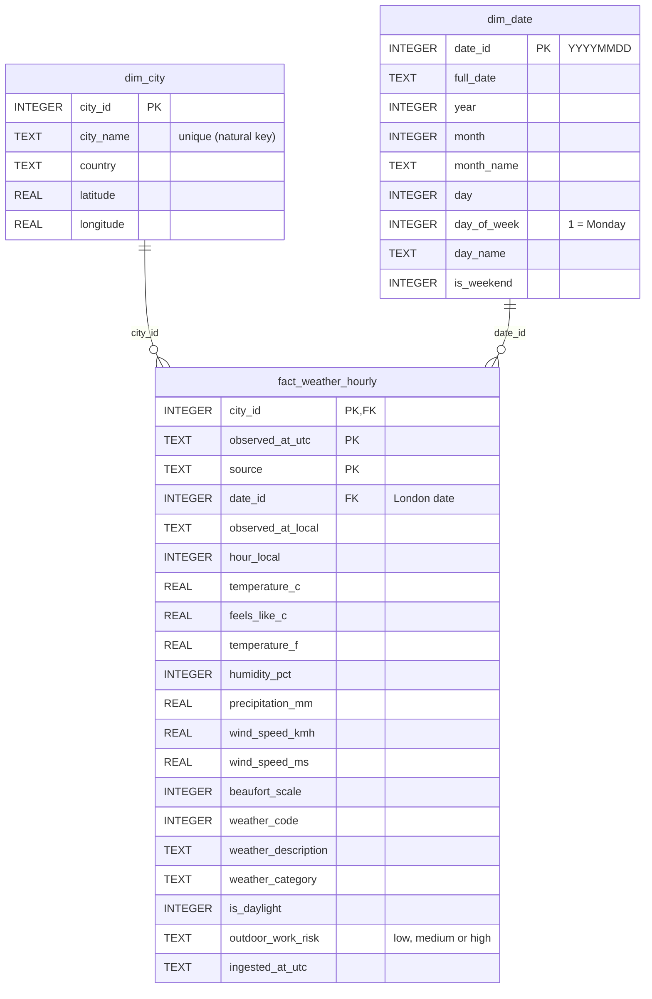

# WeatherFlow data model (star schema)

## Grain
**`fact_weather_hourly`: one row per city, per hour, per source.**
Primary key: `(city_id, observed_at_utc, source)`.

## Diagram

## Design decisions
- **`city_id` is a surrogate key** assigned by the database; `city_name` stays unique as the natural key. Cities are upserted from `config.yaml`, so adding a city needs no code change.
- **`date_id` is the London (local) date** (`YYYYMMDD`), because the business plans by UK calendar day. 23:30 UTC on 30 June is 1 July in London.
- **`source` is part of the key**, so a second weather source  can store the same city and hour without clashing.
- **The load is idempotent and atomic:** facts are upserted with `INSERT ... ON CONFLICT ... DO UPDATE`, and dimensions and facts are written in one transaction. Foreign keys are enforced with `PRAGMA foreign_keys = ON`.