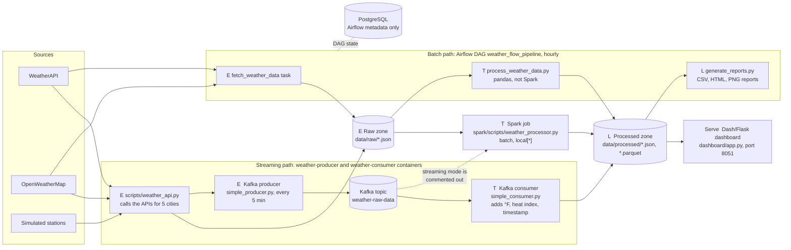

# Reference architecture: WeatherFlow-DataEngineering

How data flows from the weather APIs to the dashboard in the reference repo, based on reading the code.
Each stage is labelled **E** (extract), **T** (transform) or **L** (load). "Serve" is the read side that
uses the loaded data. A PNG version of the same diagram is in
[reference_architecture.png](reference_architecture.png).

## Reading the diagram

| Label | Stage | In this repo |
|-------|-------|--------------|
| **E** | Extract | `weather_api.py` calls the APIs and lands each response as a raw JSON file; the producer also pushes it onto Kafka. |
| **T** | Transform | Three separate transforms: the Kafka consumer, the Spark batch job and the pandas script run by Airflow. |
| **L** | Load | Results are written as files to the processed zone; reports are written from there. No weather data reaches a database. |
| Serve | Read side | The Dash dashboard reads the processed JSON files directly. |

Docker Compose packages every box above as one of 10 containers.

Two things stand out once it is drawn. First, there are three transform paths that do much the same work,
and nothing says which one is the source of truth. Second, the Kafka branch only feeds JSON files on disk,
which the batch path writes too, so the streaming layer adds no capability for an hourly feed.
